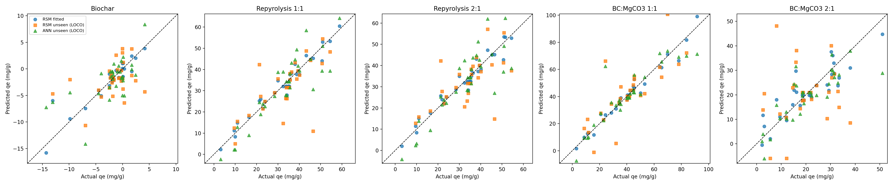
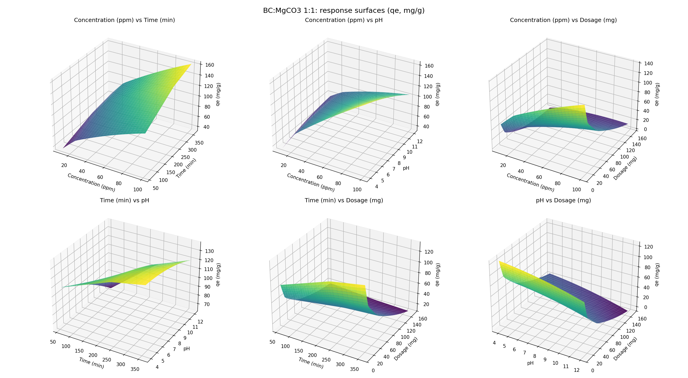
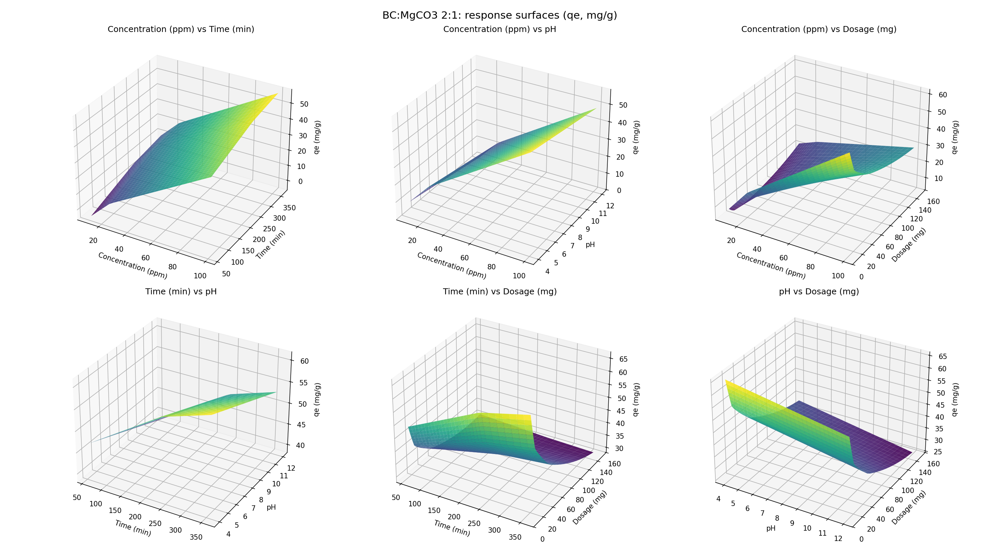
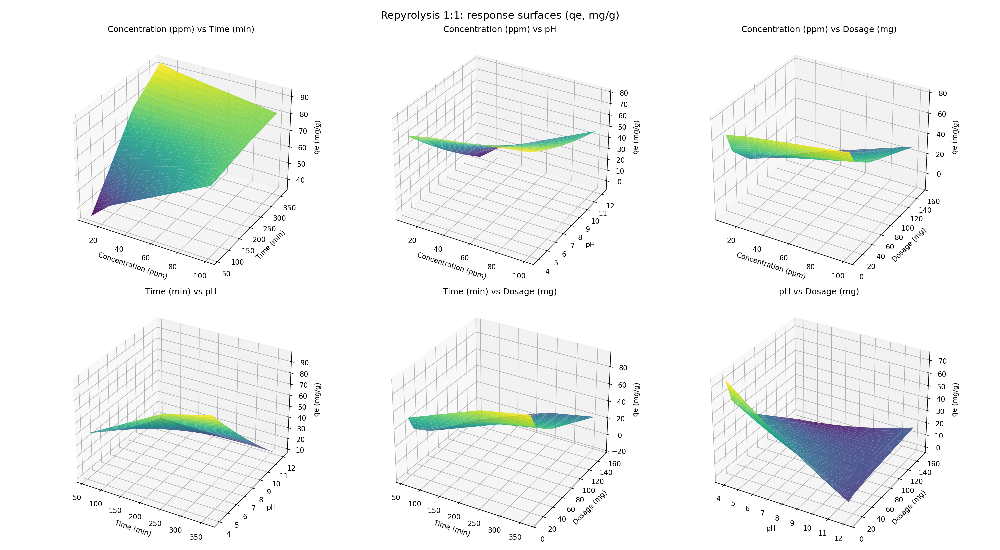
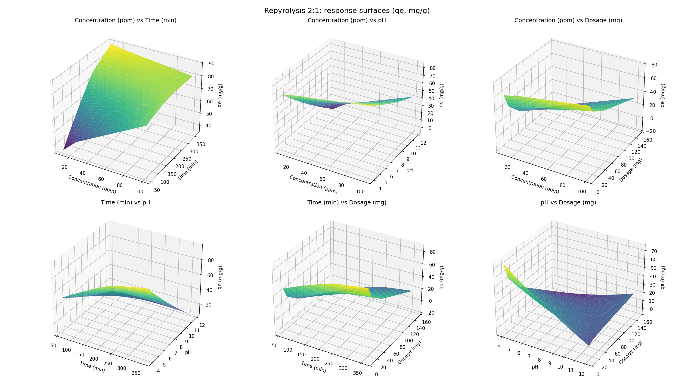
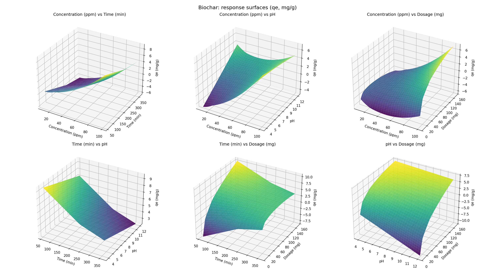

# Version 1: RSM and ANN analysis, end to end

**Run:** v1, baseline RSM + ANN
**Where:** Google Colab, CPU runtime, notebook `rsm_ann_analysis.ipynb` (v1 sections)
**Colab link:** https://colab.research.google.com/drive/1s1rngJQQXDMTjDQfb9LMWoo16Mpeg9Xr
**Run time:** about 20 minutes
**Outputs:** this folder (`RSM_ANN_results.xlsx`, `actual_vs_predicted.png`, `surface_<material>.png`)
**Data used:** the 480 laboratory measurements exactly as recorded. Nothing was added, changed, removed or synthesised.

---

## Contents
1. The problem
2. The data
3. Where the work ran (Google Colab)
4. Step-by-step: what the notebook did
5. Results, Goal 2: which material is best
6. Results, ANOVA for each material
7. Results, Goal 1: optimum conditions
8. Results, Goal 3: actual vs predicted, and accuracy
9. The figures
10. What the results mean in practice
11. Limitations
12. Glossary

---

## 1. The problem

Five adsorbent materials were tested for adsorption capacity, **qe (mg/g)**:

| Material | Role |
|---|---|
| Biochar | **Control.** Plain biochar, expected not to adsorb |
| Repyrolysis 1:1 | Enriched biochar |
| Repyrolysis 2:1 | Enriched biochar |
| BC:MgCO₃ 1:1 | Biochar enriched with magnesium carbonate |
| BC:MgCO₃ 2:1 | Biochar enriched with magnesium carbonate |

**Three goals**
1. **Optimisation:** find the Concentration, Time, pH and Dosage that give the highest qe for each material.
2. **Best material:** decide which material is best, using ANOVA.
3. **Actual vs predicted:** for each material, compare the measured qe with the model's prediction.

**Constraints, from the experimenter's voice note**
- **pH 4–8 only.** An earlier statistical analysis recommended pH 12, which cannot be recommended to farmers.
- **Low dose gives high qe.** qe is "mg adsorbed per gram of adsorbent", so a small dose (10–25 mg) gives high qe. A model that agrees with this is behaving sensibly.
- **Biochar is the control.** Its negative qe values are genuine lab readings and support the conclusion that only the enriched materials adsorb.

---

## 2. The data

**Size:** 5 materials × 32 runs × 3 replicates (R1, R2, R3) = **480 measurements**.

**Factors and their levels**

| Factor | Symbol | −2 | −1 | 0 | +1 | +2 |
|---|---|---|---|---|---|---|
| Concentration (ppm) | A | 10 | 25 | 50 | 75 | 100 |
| Contact time (min) | B | 60 | 120 | 180 | 240 | 360 |
| pH | C | 4 | 6 | 8 | 10 | 12 |
| Dosage (mg) | D | 10 | 20 | 50 | 100 | 150 |

The models use the coded values −2 to +2 (as in the data sheet), so all four factors are on the same scale.

**How the 32 runs are arranged** (the same for every material)

| Runs | Type | What changes |
|---|---|---|
| 1–4 | Centre point | Nothing: all factors at 0 (50 ppm, 180 min, pH 8, 50 mg), repeated 4 times |
| 5–8 | One factor at a time | Concentration at −1, +1, −2, +2 |
| 9–12 | One factor at a time | Time at −1, +1, −2, +2 |
| 13–16 | One factor at a time | pH at −1, +1, −2, +2 |
| 17–20 | One factor at a time | Dosage at −1, +1, −2, +2 |
| 21–28 | Factorial | All four factors at ±1 in 8 combinations |
| 29–32 | Extreme corners | All four factors at ±2 |

**Things to keep in mind about this design**
- **It is not a full central composite design (CCD).** A full CCD for 4 factors has 16 factorial runs; this design has 8. As a result some interaction effects are partly mixed together (Conc×Time and Conc×Dose correlate at 0.89).
- **Uneven spacing:** time and dose levels are not evenly spaced in real units (time jumps by 60 then 120 minutes; dose goes 10, 20, 50, 100, 150), but they are coded as evenly spaced.
- **Repyrolysis 1:1 and 2:1** have the same value in 94 of 96 measurements. The experimenter confirmed these are the real lab results.

**Why the earlier analysis gave pH 12.** pH 12 appears in only three runs: 16, 30 and 31. Run 31 also uses the highest concentration (100 ppm) and the lowest dose (10 mg), both of which push qe up strongly, and it gave the highest qe for three materials. A model sees "high qe at pH 12" and credits pH. When pH alone is changed, pH 12 is worse:

| Material | Run 15 (pH 4, others at centre) | Run 16 (pH 12, others at centre) |
|---|---|---|
| Repyrolysis 1:1 | 45.3 mg/g | 21.3 mg/g |
| BC:MgCO₃ 1:1 | 45.5 mg/g | 28.7 mg/g |
| BC:MgCO₃ 2:1 | 28.6 mg/g | 17.6 mg/g |

So pH 12 is not truly optimal. That is why v1 limits pH to 4–8 during optimisation.

---

## 3. Where the work ran: Google Colab

1. The notebook `rsm_ann_analysis.ipynb` was built with the 480 measurements embedded in a hidden cell, so no separate data file was needed.
2. It was uploaded to Google Colab (it saves to your Google Drive) and run with **Runtime → Run all** on a standard **CPU** runtime. The models are small, so no GPU is needed.
3. Libraries used, all pre-installed in Colab:

| Library | Used for |
|---|---|
| pandas, numpy | Handling the data table |
| statsmodels | RSM regression, ANOVA, prediction intervals, two-way ANOVA, Tukey HSD |
| scipy | F-tests, constrained optimisation (SLSQP) |
| scikit-learn | ANN (`MLPRegressor`), grouped cross-validation, metrics |
| matplotlib | Plots |
| openpyxl | Writing the Excel file |

4. The last cell zipped the results and downloaded them (`RSM_ANN_results.zip`). Its contents are in this folder.
5. **Random seed 42** is used everywhere, so a rerun gives the same split and the same results.

---

## 4. Step-by-step: what the notebook did

### Step 1. Load the data
- Read the 480 rows: material, run, the 4 factors (real and coded), replicate and qe.
- Runs 1–4 have identical settings, so they are marked as **one condition**. This leaves **29 distinct conditions** per material.
- A copy of every qe value is stored, to prove later that nothing changed.

### Step 2. Define the models

**RSM (Response Surface Methodology).** This is the method used in both reference papers. For each material, qe is fitted with a second-order equation:

qe = b₀ + b₁A + b₂B + b₃C + b₄D (linear)
     + b₁₁A² + b₂₂B² + b₃₃C² + b₄₄D² (quadratic)
     + b₁₂AB + b₁₃AC + b₁₄AD + b₂₃BC + b₂₄BD + b₃₄CD (interactions)

That is 15 coefficients, estimated by ordinary least squares on all 96 measurements of a material. Two versions are fitted:
- **Full model:** all 14 terms. Used for the ANOVA table, so you can see which terms are significant.
- **Reduced model:** the least significant term (p > 0.05) is removed and the model refitted, repeating until every remaining term is significant. Lower-order terms are kept when needed: if A×C is significant, A and C stay even if they are not. This *hierarchy* rule is standard practice. The reduced model is used for optimisation.

**ANN (Artificial Neural Network).** This is the method compared with RSM in Kumari et al.
- **One network for all 5 materials.** Inputs: the 4 coded factors plus the material, as five 0/1 indicator columns. Output: qe. Pooling gives the network 480 rows to learn from instead of 96.
- **Architecture:** 1 hidden layer with tanh activation (Kumari et al. use the same) and a linear output.
- **Training:** the L-BFGS solver, which works well on small datasets, for up to 5000 iterations. Inputs and output are standardised, using statistics from the training data only.
- **Tuning:** the number of hidden neurons {4, 8, 12} and the L2 regularisation strength {0.001, 0.01, 0.1}: 9 combinations. Each is scored by 4-fold **grouped** cross-validation inside the training data, so whole conditions are held out and never single replicates.
- **Final model:** the 5 networks with the best settings, each starting from a different random seed, averaged together. Averaging smooths out the randomness of any one network.

### Step 3. Split the data into training and test sets (no leakage)

**Leakage** happens when information about the test data reaches the model during training, so accuracy looks better than it really is. Four rules prevent it:

1. **Split by condition, never by row.** If replicate R1 of a run is in training and R3 is in testing, the model has effectively already seen the answer. All replicates of a run go to the same side.
2. **Hold out a condition for all 5 materials at once.** The ANN learns from every material, so otherwise it could see the test condition through another material.
3. **Stratified random choice of 6 test runs** (seed 42): one from each one-factor-at-a-time block and two from the factorial block. That way the training data still contains information about every factor. Centre runs (1–4) and extreme corners (29–32) always stay in training, so all test points lie inside the tested range.
4. **The test set is used once,** at the end. All choices (RSM terms, ANN settings, scaling) use training data only.

**Resulting split**

| Set | Runs | Measurements |
|---|---|---|
| **Test (unseen)** | **5, 12, 15, 18, 24, 27** | 90 (6 runs × 3 replicates × 5 materials) |
| Training | the other 26 runs | 390 |

| Test run | Conc | Time | pH | Dose |
|---|---|---|---|---|
| 5 | 25 | 180 | 8 | 50 |
| 12 | 50 | 360 | 8 | 50 |
| 15 | 50 | 180 | 4 | 50 |
| 18 | 50 | 180 | 8 | 100 |
| 24 | 75 | 240 | 6 | 100 |
| 27 | 75 | 120 | 6 | 100 |

The notebook confirms that no condition appears in both sets.

### Step 4. Hold-out test
- RSM (full and reduced) was fitted on each material's training rows. The ANN was tuned and trained on all training rows.
- Each model predicted the 6 test runs it had never seen.
- Scores are computed on **run means** (the average of the 3 replicates against the prediction): R², RMSE and MAE, per material and overall.

### Step 5. Leave-one-condition-out (LOCO)
Six test runs is a small sample, and the result depends on which 6 were chosen. LOCO gives a steadier estimate:
- For each of the 29 conditions in turn: remove it, fit and **re-tune** every model from scratch on the other 28, then predict the removed one.
- In the end, every condition has been predicted once by a model that never saw it.
- This is "nested": the ANN tuning is repeated inside every fold, so no information leaks in through the tuning either.

### Step 6. Final RSM on all data, with ANOVA
For each material, RSM was fitted on all 96 measurements. The notebook reports:
- **ANOVA table:** for the model and each term: sum of squares, F-value, p-value, and whether it is significant (p < 0.05).
- **Lack of fit:** the model's error compared with the scatter between replicates (pure error).
- **R², adjusted R², predicted R²,** standard deviation and the model p-value.

### Step 7. Goal 1, optimisation
For each material, the reduced RSM was used to find the factor settings that give the **highest predicted qe**:
- **Hard limits:** Concentration 10–100, Time 60–360, Dose 10–150, and **pH 4–8**.
- **Stay inside the tested region (leverage limit):** the search may not move further from the experimental runs than the runs themselves extend. This stops the model inventing very high qe values at untested combinations of settings.
- **Method:** the SLSQP constrained optimiser, started from 40 random points, keeping the best result.
- **Reported:** the optimum settings, the predicted qe with its 95% prediction interval, and the ANN's prediction at the same point as an independent cross-check.
- For comparison only, the optimisation was repeated with pH allowed from 4 to 12.

### Step 8. Lab validation plan
The optimum settings were rounded to practical lab values (concentration to 5 ppm, time to 10 min, pH to 0.5, dose to 5 mg) and qe predicted again at those settings. This is the plan for the confirmation experiments.

### Step 9. Goal 2, comparing materials
- **Two-way ANOVA** on all 480 measurements: qe ~ material + condition + material × condition. This tests whether material has a real effect.
- **Tukey HSD:** compares every pair of materials and says which differences are real.
- **Ranking table:** mean qe, best observed qe, the optimum qe, R², adjusted R², predicted R², and LOCO R² for RSM and ANN.

### Step 10. Goal 3, actual vs predicted
For every material and run: the actual qe (mean ± SD of the replicates), the RSM fitted value, and the **unseen** predictions from RSM and ANN (from LOCO). The notebook shows a summary; the full table is in the Excel file.

### Step 11. Figures, then export
- Actual-vs-predicted scatter plots, and 6 response-surface plots per material.
- Everything is written to the Excel workbook and PNG files, then zipped.

---

## 5. Results, Goal 2: which material is best

### 5.1 Ranking

| Rank | Material | Mean qe (mg/g) | Best observed qe | Optimum qe (RSM, pH 4–8) | R² | Adj R² | Pred R² |
|---|---|---|---|---|---|---|---|
| **1** | **BC:MgCO₃ 1:1** | **40.7** | **91.5** | **112.7** | **0.962** | **0.956** | **0.948** |
| 2 | Repyrolysis 1:1 | 32.9 | 58.8 | 64.4 | 0.943 | 0.936 | 0.932 |
| 3 | Repyrolysis 2:1 | 32.6 | 54.4 | 65.1 | 0.935 | 0.927 | 0.920 |
| 4 | BC:MgCO₃ 2:1 | 20.9 | 51.1 | 52.9 | 0.744 | 0.724 | 0.692 |
| 5 | Biochar (control) | −2.1 | 4.2 | 6.8 | 0.793 | 0.768 | 0.734 |

(R² values are for the reduced model on all data.)

### 5.2 Two-way ANOVA (all 480 measurements)

| Source | F | p-value | Meaning |
|---|---|---|---|
| Material | 6637 | < 0.001 | The materials differ strongly |
| Condition | 424 | < 0.001 | The experimental settings strongly affect qe |
| Material × condition | 90 | < 0.001 | Materials respond to the settings differently |

### 5.3 Tukey HSD: which pairs differ

| Comparison | Mean difference (mg/g) | p | Different? |
|---|---|---|---|
| BC:MgCO₃ 1:1 vs Repyrolysis 1:1 | 7.8 | 0.001 | Yes |
| BC:MgCO₃ 1:1 vs Repyrolysis 2:1 | 8.1 | < 0.001 | Yes |
| BC:MgCO₃ 1:1 vs BC:MgCO₃ 2:1 | 19.9 | < 0.001 | Yes |
| BC:MgCO₃ 1:1 vs Biochar | 42.8 | < 0.001 | Yes |
| Repyrolysis 1:1 vs BC:MgCO₃ 2:1 | 12.0 | < 0.001 | Yes |
| Repyrolysis 2:1 vs BC:MgCO₃ 2:1 | 11.8 | < 0.001 | Yes |
| Repyrolysis (either) vs Biochar | 34.7–34.9 | < 0.001 | Yes |
| BC:MgCO₃ 2:1 vs Biochar | 22.9 | < 0.001 | Yes |
| **Repyrolysis 1:1 vs Repyrolysis 2:1** | **0.2** | **1.000** | **No** |

### 5.4 Conclusion for Goal 2
- **BC:MgCO₃ 1:1 is the best material.** It has the highest average and best observed qe, the highest optimum qe, and the best-fitting model, and it is significantly better than every other material.
- **Enrichment works.** Every enriched material adsorbs far more than plain biochar, by 23–43 mg/g on average.
- **Ratio:** for MgCO₃, 1:1 is clearly better than 2:1 (19.9 mg/g higher). For repyrolysis, the ratio makes no difference.
- **Biochar (control)** averages −2.1 mg/g: it does not adsorb, as expected.

---

## 6. Results, ANOVA for each material (full quadratic model)

**How to read this:** p < 0.05 means the term really affects qe; "No" means its effect cannot be told apart from noise. Terms are A = Concentration, B = Time, C = pH, D = Dose.

### 6.1 Significant (✔) and non-significant (✘) terms

| Term | Type | Biochar | Repyrolysis 1:1 | Repyrolysis 2:1 | BC:MgCO₃ 1:1 | BC:MgCO₃ 2:1 |
|---|---|---|---|---|---|---|
| A (Conc) | Linear | ✘ | ✔ | ✔ | ✔ | ✔ |
| B (Time) | Linear | ✘ | ✔ | ✔ | ✔ | ✔ |
| C (pH) | Linear | ✘ | ✔ | ✔ | ✔ | ✔ |
| D (Dose) | Linear | ✔ | ✔ | ✔ | ✔ | ✔ |
| A² | Quadratic | ✔ | ✘ | ✘ | ✔ | ✘ |
| B² | Quadratic | ✘ | ✘ | ✘ | ✘ | ✘ |
| C² | Quadratic | ✘ | ✔ | ✔ | ✔ | ✘ |
| D² | Quadratic | ✔ | ✘ | ✘ | ✔ | ✔ |
| A×B | Interaction | ✘ | ✔ | ✔ | ✔ | ✘ |
| A×C | Interaction | ✔ | ✔ | ✔ | ✔ | ✘ |
| A×D | Interaction | ✘ | ✔ | ✔ | ✔ | ✔ |
| B×C | Interaction | ✘ | ✔ | ✔ | ✘ | ✘ |
| B×D | Interaction | ✔ | ✘ | ✘ | ✔ | ✘ |
| C×D | Interaction | ✘ | ✔ | ✔ | ✘ | ✔ |

### 6.2 Model statistics

| Material | Model p | R² | Adj R² | Pred R² | Std dev (mg/g) | Lack of fit p |
|---|---|---|---|---|---|---|
| Biochar | 2.3×10⁻²² | 0.797 | 0.762 | 0.726 | 1.99 | < 0.001 |
| Repyrolysis 1:1 | 8.6×10⁻⁴⁵ | 0.945 | 0.935 | 0.926 | 3.41 | < 0.001 |
| Repyrolysis 2:1 | 2.1×10⁻⁴² | 0.937 | 0.926 | 0.915 | 3.54 | < 0.001 |
| BC:MgCO₃ 1:1 | 1.2×10⁻⁵¹ | 0.963 | 0.956 | 0.948 | 4.46 | < 0.001 |
| BC:MgCO₃ 2:1 | 2.7×10⁻²⁰ | 0.771 | 0.731 | 0.656 | 5.93 | < 0.001 |

(Full-model values; reduced-model values are in the "Fit summary" sheet.)

### 6.3 What the ANOVA says

**BC:MgCO₃ 1:1 (best material)**
- **Dose is by far the strongest factor** (F = 837): lower dose gives much higher qe, which matches the experimenter's observation.
- **Concentration is next** (F = 298): higher concentration gives higher qe.
- **Time and pH matter but are weaker** (F = 31 and 35).
- **D² is significant (F = 68):** the drop in qe with dose is steep at low dose and flattens at high dose, which is the expected 1/dose shape.
- **The Conc×pH interaction is strong (F = 76):** the best pH depends on the concentration.

**Repyrolysis 1:1 and 2:1** have almost identical patterns, as expected from their near-identical data:
- All linear terms are significant, with concentration the strongest (F ≈ 290–310) and then dose (F ≈ 150–160).
- **pH×Dose is strong (F ≈ 64)** and pH² is significant, so pH has a curved effect.

**BC:MgCO₃ 2:1**
- Concentration dominates (F = 47). The other effects are weak.
- The model fits worse (R² 0.77, predicted R² 0.66), so its predictions are less certain.

**Biochar (control)**
- Only dose and a few higher-order terms are significant. The values are small (around −2 mg/g) and mostly noise, which is consistent with a material that does not adsorb.

**Lack of fit is significant for every material.** The replicates are very consistent (pure-error SD about 2 mg/g), so this test notices even small misfits. The Nguyen et al. paper reported the same. It means a quadratic cannot capture every detail; that is why the ANN was also tested.

**Model R² and the earlier statistician.** BC:MgCO₃ 2:1 gives R² = 0.77 here, against 0.78 from the earlier statistician, so the RSM setup matches theirs.

---

## 7. Results, Goal 1: optimum conditions

### 7.1 Optimum with pH limited to 4–8 (reduced RSM)

| Material | Conc (ppm) | Time (min) | pH | Dose (mg) | RSM qe | 95% prediction interval | ANN qe at this point | Best observed qe |
|---|---|---|---|---|---|---|---|---|
| Repyrolysis 1:1 | 29.9 | 157.8 | 4.6 | 12.9 | 64.4 | 56.7–72.0 | 49.6 | 58.8 |
| Repyrolysis 2:1 | 31.3 | 152.7 | 4.9 | 11.1 | 65.1 | 57.2–73.1 | 49.5 | 54.4 |
| **BC:MgCO₃ 1:1** | **65.9** | **186.9** | **8.0** | **10.3** | **112.7** | **102.6–122.8** | **93.8** | **91.5** |
| BC:MgCO₃ 2:1 | 100.0 | 229.4 | 8.0 | 16.4 | 52.9 | 39.6–66.2 | 50.0 | 51.1 |
| Biochar (control) | — | — | — | — | not optimised | — | — | 4.2 |

### 7.2 Lab validation plan (rounded to practical settings)

| Material | Conc (ppm) | Time (min) | pH | Dose (mg) | RSM qe | 95% PI | ANN qe |
|---|---|---|---|---|---|---|---|
| **BC:MgCO₃ 1:1** | **65** | **190** | **8.0** | **10** | **113.8** | **103.6–123.9** | **94.0** |
| Repyrolysis 1:1 | 30 | 160 | 4.5 | 15 | 61.4 | 53.9–68.9 | 48.0 |
| Repyrolysis 2:1 | 30 | 150 | 5.0 | 10 | 65.2 | 57.2–73.2 | 49.9 |
| BC:MgCO₃ 2:1 | 100 | 230 | 8.0 | 15 | 54.7 | 41.1–68.3 | 52.4 |

**How to validate:** run each setting in the lab with 3 replicates. If the mean measured qe falls inside the 95% prediction interval, the model is confirmed.

### 7.3 For comparison: pH allowed from 4 to 12

| Material | pH found (4–12) | pH found (4–8) | qe at 4–12 | qe at 4–8 |
|---|---|---|---|---|
| Repyrolysis 1:1 | 10.7 | 4.6 | 65.0 | 64.4 |
| Repyrolysis 2:1 | 4.9 | 4.9 | 65.1 | 65.1 |
| BC:MgCO₃ 1:1 | 8.6 | 8.0 | 112.9 | 112.7 |
| BC:MgCO₃ 2:1 | 9.6 | 8.0 | 53.4 | 52.9 |

**Allowing high pH gains almost nothing:** at most 0.6 mg/g, well within the prediction uncertainty. Limiting pH to 4–8 for farmer-practical use costs essentially no adsorption. And because the search stays inside the tested region, no material comes out at pH 12.

### 7.4 What the optimum results mean
- **Dose:** the optimum is **10–16 mg** for every enriched material, matching the experimenter's observation that low dose gives high qe.
- **pH:** the repyrolysis materials prefer **acidic pH (4.5–5)**. The MgCO₃ materials sit at **pH 8**, the upper limit, so they would prefer slightly higher pH, but pH 8 is the practical choice.
- **BC:MgCO₃ 1:1 optimum:** 65 ppm, 190 min, pH 8, 10 mg.
  - RSM predicts about 114 mg/g. The ANN predicts about 94 mg/g, close to the best value measured so far (91.5 mg/g, run 19).
  - RSM tends to overestimate near the edge of the data (see section 8), so **a realistic expectation is 90–115 mg/g.** The validation experiment will settle it.

---

## 8. Results, Goal 3: actual vs predicted, and accuracy

### 8.1 Hold-out test (6 runs the models never saw)

| Material | RSM full R² | RSM reduced R² | **ANN R²** | ANN RMSE (mg/g) | ANN MAE (mg/g) |
|---|---|---|---|---|---|
| Repyrolysis 1:1 | 0.224 | 0.112 | **0.966** | 1.41 | 1.18 |
| Repyrolysis 2:1 | 0.338 | 0.153 | **0.970** | 1.32 | 1.07 |
| BC:MgCO₃ 1:1 | 0.334 | 0.470 | **0.783** | 4.44 | 3.49 |
| BC:MgCO₃ 2:1 | −3.112 | −1.193 | 0.042 | 8.18 | 5.67 |
| Biochar (control) | −5.064 | −4.372 | −1.256 | 1.99 | 1.84 |
| **All materials** | 0.613 | 0.727 | **0.918** | **4.35** | **2.65** |

### 8.2 Leave-one-condition-out (all 29 conditions, each unseen)

| Material | RSM full R² | RSM reduced R² | **ANN R²** | ANN RMSE | ANN MAE |
|---|---|---|---|---|---|
| Repyrolysis 1:1 | 0.403 | 0.455 | **0.729** | 6.88 | 5.18 |
| Repyrolysis 2:1 | 0.312 | 0.325 | **0.614** | 7.97 | 5.88 |
| BC:MgCO₃ 1:1 | 0.631 | 0.532 | **0.813** | 9.12 | 5.33 |
| BC:MgCO₃ 2:1 | −3.592 | −2.969 | **0.645** | 6.66 | 4.71 |
| Biochar (control) | −0.846 | −0.970 | **0.331** | 3.21 | 2.48 |
| **All materials** | 0.519 | 0.540 | **0.878** | **7.05** | **4.72** |

### 8.3 The highest-qe run of each material: actual vs predicted

| Material | Run | Actual qe | RSM fitted | RSM unseen | ANN unseen |
|---|---|---|---|---|---|
| BC:MgCO₃ 1:1 | 19 | 91.5 | 99.1 | 121.6 | 71.4 |
| Repyrolysis 1:1 | 31 | 58.8 | 60.4 | 72.6 | 64.3 |
| Repyrolysis 2:1 | 26 | 54.4 | 52.9 | 37.6 | 38.7 |
| BC:MgCO₃ 2:1 | 31 | 51.1 | 44.7 | −20.3 | 28.9 |
| Biochar | 32 | 4.2 | 3.8 | −4.3 | 8.4 |

(The full run-by-run table, 160 rows, is in the Excel sheet "Actual vs predicted".)

### 8.4 What the accuracy results mean
1. **RSM fits its own data very well (R² up to 0.96) but predicts new conditions much less well** (unseen R² 0.54 overall). It has 15 coefficients for only 29 conditions, and the quadratic shape cannot follow the steep 1/dose curve. A high training R² alone overstates how good RSM is.
2. **The ANN predicts unseen conditions far better:** test R² 0.918 and LOCO R² 0.878, against 0.727 and 0.540 for RSM. It learns from all 480 measurements and can follow curved shapes.
3. **By material:**
   - **Repyrolysis:** the ANN is almost perfect on the test runs (R² about 0.97, error about 1 mg/g).
   - **BC:MgCO₃ 1:1:** good (R² 0.78–0.81).
   - **BC:MgCO₃ 2:1:** the hardest. Its R² on the 6 test runs is low because those runs vary little for this material, so even small errors lower R². Under LOCO the ANN reaches 0.645, while RSM fails completely.
   - **Biochar:** low R² is expected. Its values are near zero and mostly noise, which confirms that the control does not adsorb.
4. **Extreme corners are hardest to predict unseen** (for example, run 31 for BC:MgCO₃ 2:1). Each corner is the only run at its combination of settings, so predicting it without it is extrapolation.
5. **What to report:**
   - Use **RSM** for the ANOVA and significance (Goal 2, section 6). That is the standard, interpretable method.
   - Use the **ANN** as the more accurate predictor (Goal 3), as Kumari et al. did.
   - Give both the hold-out and LOCO numbers.

---

## 9. The figures

**`actual_vs_predicted.png`**
- One panel per material.
- x-axis: measured qe. y-axis: predicted qe. Dashed line: perfect prediction.
- Blue circles: RSM fitted on all data. Orange squares: RSM predicting unseen runs. Green triangles: ANN predicting unseen runs.
- Points close to the line mean good predictions. The green triangles stay closer to the line than the orange squares, which shows the ANN predicts unseen runs better.

**`surface_<material>.png`**
- Six 3-D response surfaces per material, one per factor pair: Conc vs Time, Conc vs pH, Conc vs Dose, Time vs pH, Time vs Dose, pH vs Dose (the comparison requested in the data sheet).
- The two factors not shown are held at that material's pH-limited optimum.
- The height is the qe predicted by the reduced RSM.
- They show, for example, qe rising steeply as dose falls and as concentration rises.

---

## 10. What the results mean in practice

1. **Recommend BC:MgCO₃ 1:1.** It is the best adsorbent by every measure.
2. **Recommended conditions:** about 65 ppm, 190 min, **pH 8** and **10 mg** dose. These are practical for farmers and give an expected qe of about 90–115 mg/g.
3. **The dose effect is the main lever:** small doses give the highest qe per gram.
4. **Repyrolysis is a solid second choice.** The 1:1 and 2:1 ratios perform the same, and the best pH is acidic (4.5–5).
5. **Enrichment is essential.** Plain biochar does not adsorb.
6. **Next step:** confirm the optimum with the lab validation runs in section 7.2.

---

## 11. Limitations

- **Small dataset:** 29 distinct conditions per material. Accuracy on 6 test runs depends on which runs were chosen, which is why LOCO is reported too.
- **Design:** not a full CCD, so some interactions are partly mixed together, and time and dose levels are unevenly spaced.
- **Lack of fit is significant** for all materials, so a quadratic is an approximation.
- **Measurement noise:** replicates differ by about 2 mg/g. No model can be more precise than that.
- **Optimum predictions** near the edge of the data (low dose) carry the most uncertainty, and the RSM and ANN predictions differ there. Lab validation is needed.

---

## 12. Glossary

| Term | Meaning |
|---|---|
| qe | Adsorption capacity: mg of adsorbate removed per g of adsorbent |
| RSM | Response Surface Methodology: fits a quadratic equation to the experiment |
| ANN | Artificial Neural Network: a flexible model that learns curved relationships |
| ANOVA | Analysis of variance: tests whether effects are real or just noise |
| p-value | Probability of seeing the effect by chance; p < 0.05 means significant |
| F-value | Signal-to-noise ratio for a term; larger means a stronger effect |
| R² | Share of the variation in qe explained by the model (1 = perfect) |
| Adjusted R² | R² with a penalty for extra terms |
| Predicted R² | R² for points left out of the fit, measuring prediction ability |
| RMSE | Root mean squared error: typical error in mg/g, sensitive to large errors |
| MAE | Mean absolute error: average error size in mg/g |
| Lack of fit | Test of whether the model's error exceeds the replicate scatter |
| Pure error | Scatter between replicates of the same run (measurement noise) |
| Hold-out test | Data kept aside and used only once, to score the final models |
| LOCO | Leave-one-condition-out: each condition predicted by a model trained without it |
| Data leakage | Test information reaching training, which makes accuracy look better than it is |
| Tukey HSD | A test comparing every pair of groups while controlling false positives |
| Prediction interval | The range where a new measurement is expected to fall (95% of the time) |
| Hierarchy | Keeping a lower-order term (such as A) when a higher-order term containing it (such as A×C) is in the model |
| Leverage limit | A constraint keeping the optimiser inside the region the experiments covered |
