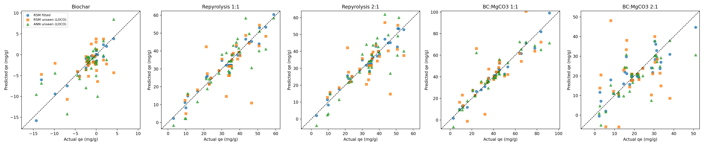

# Version 2: improving accuracy with the same data, end to end

**Run:** v2 = v1 + accuracy-improvement methods
**Where:** Google Colab, **T4 GPU runtime** (mercurythefirst001@gmail.com account), notebook `rsm_ann_v2.ipynb` (in this folder)
**Colab link:** https://colab.research.google.com/drive/1rWQat80Ue99-leizVeROoQOYSrzqOzYH?authuser=4
**Run time:** about 30 minutes
**Outputs:** this folder (`RSM_ANN_results.xlsx`, `actual_vs_predicted.png`, `surface_<material>.png`, `rsm_ann_v2.ipynb`)
**Data used:** the same 480 laboratory measurements. **No value was added, changed, removed or synthesised.** The notebook stops with an error if any measured value differs from the original, and the check passed: "all 480 measured qe values are unchanged".

---

## Contents
1. Why v2 was run
2. What stayed the same as v1
3. Where it ran (Google Colab, T4)
4. The new methods, explained
5. How the models were compared fairly
6. Results: comparison of all 12 models
7. Results by material
8. Results: actual vs predicted
9. Results: validation predictions at the optimum
10. What the results mean
11. Limitations
12. Next step: v3

---

## 1. Why v2 was run

In v1 the ANN predicted unseen conditions much better than RSM (test R² 0.918 vs 0.727). The question for v2 was: **can accuracy improve further using only the existing data**, without new experiments and without making up data?

---

## 2. What stayed the same as v1

All of v1 runs again unchanged, so these results are **identical to v1**:
- the train/test split (test runs 5, 12, 15, 18, 24, 27)
- the RSM ANOVA tables and the significant terms for every material
- R², adjusted R² and predicted R²
- the optimum conditions at pH 4–8, and the lab validation plan
- the two-way ANOVA, Tukey HSD and material ranking (BC:MgCO₃ 1:1 is best)
- the response-surface figures

See `results/v1/V1_REPORT.md` for the full explanation of those parts. v2 adds sections on top.

Re-running v1's ANN gives the same test R² (0.918). Its leave-one-out R² is 0.876 instead of 0.878, a tiny difference from running folds in parallel on a different machine.

---

## 3. Where it ran: Google Colab, T4

1. The notebook was uploaded to Colab in the **mercurythefirst001@gmail.com** account and run with **Runtime → Run all** on a **T4 GPU runtime**. The notebook now defaults to T4.
   - Earlier attempts were stopped: one when the laptop turned off, and one on sanishnevil@gmail.com, where Colab refused a GPU because of usage limits.
2. **Note on the GPU:** every model here comes from scikit-learn or statsmodels, which compute on the **CPU only**. The T4 was attached but not used for computing; results and speed would be the same on a CPU runtime.
3. **Leave-one-out folds ran in parallel** on the runtime's 2 CPU cores (joblib), which roughly halved the run time.
4. The results zip was downloaded and its contents placed in this folder.

---

## 4. The new methods, explained

None of these methods adds data. They change **how the models read the existing columns**.

### 4.1 conc ÷ dose as an extra input
- Adsorption capacity is defined as **qe = (C₀ − Ce) × V / m**: the amount adsorbed divided by the adsorbent mass.
- So qe naturally grows with **concentration** and shrinks with **dose**, roughly in proportion to concentration ÷ dose.
- v1's models had to discover this from about 30 conditions. v2 adds **log(conc ÷ dose)**, calculated from the existing columns, as an extra input. This gives the model the main physical pattern directly.

### 4.2 "Removal-space" target
- Instead of predicting qe directly, the model predicts **T = qe × dose ÷ conc**. That is proportional to the *fraction* of phosphate removed, which varies more smoothly.
- Each prediction is converted back exactly: **qe = T × conc ÷ dose**. No measured value changes.
- This was tried for RSM, the ANN and the Gaussian Process.

### 4.3 Weighted RSM
- Some conditions have very consistent replicates and others are noisier.
- Weighted least squares gives each condition a weight of **1 ÷ its replicate variance**, so consistent conditions count more. To prevent extreme weights, no variance is allowed below the median.
- Weights come from training data only.

### 4.4 Gaussian Process Regression (GPR)
- A model often among the most accurate for under 100 data points. It also gives an uncertainty for each prediction.
- One model per material, with inputs Conc, Time, pH, Dose and log(conc/dose), standardised using training data only.
- Kernel: constant × RBF with **one length-scale per input** (it learns how quickly qe changes along each factor), plus a white-noise term for measurement scatter.
- The kernel settings are fitted automatically by maximising the likelihood, with 2 restarts.

### 4.5 Monotonic gradient boosting
- A decision-tree ensemble (scikit-learn `HistGradientBoostingRegressor`) that is **forced** to respect what you know:
  - qe **rises** with concentration
  - qe **falls** with dose
  - qe **rises** with conc ÷ dose
- This stops the model learning implausible wiggles from small data.
- One model for the 4 enriched materials, with material as an input. Biochar, the control, gets its own model without the constraint, because its values behave differently.
- Tuned by grouped 4-fold CV on training data: learning rate {0.05, 0.1} × tree size {7, 15 leaves}, 300 trees, at least 5 samples per leaf.

### 4.6 RSM + ANN residual (hybrid)
- RSM captures the main quadratic trend for each material. An ANN is then trained on **what RSM got wrong** (the residuals), and the two predictions are added together.

### 4.7 ANN + conc/dose
- The same pooled ANN as v1, plus the log(conc/dose) input.
- Tuned by grouped 3-fold CV on training data: neurons {4, 8, 12} × L2 {0.01, 0.1}.
- Final model: the average of 10 networks (v1 averaged 5).

### 4.8 Ensemble (ANN + GPR)
- The average of the **ANN + conc/dose** and **GPR + conc/dose** predictions.
- This pairing was **fixed before seeing any results,** so it is not cherry-picked.

---

## 5. How the models were compared fairly

All 12 models went through exactly the same evaluation as v1:
1. **Hold-out test:** trained on the 26 training runs, scored once on the 6 untouched test runs.
2. **Leave-one-condition-out (LOCO):** every one of the 29 conditions is predicted by a model fitted **and tuned** from scratch without it.
3. **All tuning happens inside the training data** (grouped CV: replicates and all materials at a condition stay together).
4. **Scores are computed on run means:** the mean of 3 replicates against the prediction.

The model with the **lowest LOCO error (RMSE)** was named "best".

---

## 6. Results: comparison of all 12 models (all materials together)

Sorted by leave-one-out error (lower is better).

| Rank | Model | Test R² | Test RMSE | Test MAE | **LOCO R²** | **LOCO RMSE** | LOCO MAE |
|---|---|---|---|---|---|---|---|
| **1** | **Ensemble (ANN + GPR)** | 0.907 | 4.62 | 3.10 | **0.887** | **6.78** | **4.27** |
| 2 | **ANN + conc/dose** | **0.927** | **4.08** | 2.72 | 0.882 | 6.94 | 4.33 |
| 3 | ANN (v1) | 0.918 | 4.34 | **2.63** | 0.876 | 7.11 | 4.71 |
| 4 | Monotonic boosting | 0.756 | 7.48 | 5.60 | 0.852 | 7.77 | 5.16 |
| 5 | GPR + conc/dose | 0.869 | 5.48 | 3.68 | 0.849 | 7.85 | 4.98 |
| 6 | RSM weighted | 0.676 | 8.62 | 5.12 | 0.618 | 12.49 | 8.20 |
| 7 | ANN removal-space | 0.915 | 4.42 | 2.81 | 0.569 | 13.27 | 5.84 |
| 8 | RSM + ANN residual | 0.754 | 7.51 | 5.12 | 0.552 | 13.53 | 7.93 |
| 9 | RSM reduced (v1) | 0.727 | 7.91 | 5.81 | 0.540 | 13.71 | 8.38 |
| 10 | RSM full (v1) | 0.613 | 9.41 | 6.15 | 0.519 | 14.02 | 8.60 |
| 11 | GPR removal-space | 0.838 | 6.09 | 3.94 | −1.525 | 32.12 | 10.02 |
| 12 | RSM removal-space | 0.467 | 11.04 | 5.98 | −3.229 | 41.57 | 14.52 |

**Key findings**
1. **The best model is the ANN + GPR ensemble.** It has the lowest leave-one-out error: **6.78 mg/g** against 7.11 for v1's ANN, a 5% reduction, with LOCO R² 0.887.
2. **ANN + conc/dose** has the **best hold-out test score** (R² 0.927, RMSE 4.08) and nearly the best LOCO. Adding the physics input helped the ANN.
3. **Every flexible model** (ANN, GPR, boosting) beats every RSM variant on unseen data. Even the improved RSMs (weighted, hybrid) only reach LOCO R² of about 0.55–0.62.
4. **The removal-space target failed on unseen extremes.** On the hold-out runs it looked fine (ANN 0.915), but on leave-one-out it collapsed (GPR −1.5, RSM −3.2). The reason: converting back multiplies every error by conc ÷ dose, which reaches **10** at the extreme corners (100 ppm, 10 mg), so a small error in T becomes a huge error in qe. **Lesson:** don't use it.
5. **Monotonic boosting** is good on leave-one-out (0.852) but weaker on the 6 hold-out runs (0.756). Tree models step rather than curve, which hurts on the smooth middle runs.
6. **The improvement is real but modest,** as expected: with 29 conditions per material and about 2 mg/g of measurement noise, the room for improvement is limited.

---

## 7. Results by material (R²)

### 7.1 Hold-out test (6 unseen runs)

| Model | BC:MgCO₃ 1:1 | BC:MgCO₃ 2:1 | Biochar | Repyrolysis 1:1 | Repyrolysis 2:1 |
|---|---|---|---|---|---|
| ANN (v1) | 0.784 | 0.041 | −1.244 | **0.968** | **0.971** |
| **ANN + conc/dose** | **0.853** | **0.240** | **0.319** | 0.887 | 0.852 |
| Ensemble (ANN+GPR) | 0.743 | 0.065 | −0.166 | 0.870 | 0.858 |
| GPR + conc/dose | 0.479 | −0.131 | −1.665 | 0.835 | 0.844 |
| Monotonic boosting | 0.136 | −0.810 | −0.631 | 0.416 | 0.364 |
| RSM reduced (v1) | 0.470 | −1.193 | −4.372 | 0.112 | 0.153 |

### 7.2 Leave-one-condition-out (all 29 conditions)

| Model | BC:MgCO₃ 1:1 | BC:MgCO₃ 2:1 | Biochar | Repyrolysis 1:1 | Repyrolysis 2:1 |
|---|---|---|---|---|---|
| ANN (v1) | 0.804 | **0.583** | 0.228 | **0.755** | 0.643 |
| ANN + conc/dose | 0.850 | 0.432 | **0.640** | 0.721 | 0.702 |
| **Ensemble (ANN+GPR)** | 0.868 | 0.434 | 0.569 | 0.731 | **0.716** |
| GPR + conc/dose | 0.818 | 0.288 | 0.317 | 0.625 | 0.621 |
| Monotonic boosting | **0.892** | 0.124 | 0.438 | 0.596 | 0.607 |
| RSM reduced (v1) | 0.532 | −2.969 | −0.970 | 0.455 | 0.325 |

**What this shows**
- **BC:MgCO₃ 1:1 (best material):** clearly improved. LOCO R² rose from 0.80 (v1 ANN) to **0.87** with the ensemble and **0.89** with monotonic boosting. The physics input works best here, where dose has the strongest effect.
- **BC:MgCO₃ 2:1:** still the hardest. Among the models in this table, the v1 ANN is best on leave-one-out (0.58); the conc/dose input did not help this material. (ANN removal-space reached 0.63 here but fails badly on other materials; see section 6.)
- **Repyrolysis:** all ANN versions are similar (0.64–0.76 LOCO). On the 6 hold-out runs the v1 ANN is excellent (0.97).
- **Biochar (control):** values near zero are mostly noise. The physics input helps a little (0.64), but low scores are expected and not a concern.
- **No single model wins every material,** which is why the **ensemble** (averaging two good models) is the safest overall choice.

---

## 8. Results: actual vs predicted (highest-qe run of each material, predicted while unseen)

| Material | Run | Actual qe | RSM (unseen) | ANN (unseen) | **Ensemble (unseen)** |
|---|---|---|---|---|---|
| BC:MgCO₃ 1:1 | 19 | 91.5 | 121.6 | 71.3 | **93.4** |
| Repyrolysis 1:1 | 31 | 58.8 | 72.6 | **58.4** | 51.3 |
| Repyrolysis 2:1 | 26 | 54.4 | 37.6 | 40.2 | **41.0** |
| BC:MgCO₃ 2:1 | 31 | 51.1 | −20.3 | **30.7** | 16.9 |
| Biochar | 32 | 4.2 | −4.3 | 8.5 | **1.4** |

For BC:MgCO₃ 1:1's best run (91.5 mg/g, 10 mg dose), the ensemble predicts **93.4** without ever having seen that run, while RSM overshoots to 121.6 and the ANN undershoots to 71.3. That matters most, because this is the region of the recommended optimum.

The full run-by-run table, with columns RSM fitted, RSM unseen, ANN unseen and Ensemble unseen, is in the Excel sheet "Actual vs predicted". The plot is `actual_vs_predicted.png`.

---

## 9. Results: validation predictions at the optimum (pH 4–8)

The same optimum settings as v1 (from RSM), now also predicted by the ANN and the best model:

| Material | Conc | Time | pH | Dose | RSM qe | 95% PI | ANN qe | **Ensemble qe** |
|---|---|---|---|---|---|---|---|---|
| **BC:MgCO₃ 1:1** | 65 | 190 | 8.0 | 10 | 113.8 | 103.6–123.9 | 93.3 | **89.5** |
| Repyrolysis 1:1 | 30 | 160 | 4.5 | 15 | 61.4 | 53.9–68.9 | 48.9 | **51.8** |
| Repyrolysis 2:1 | 30 | 150 | 5.0 | 10 | 65.2 | 57.2–73.2 | 51.4 | **50.1** |
| BC:MgCO₃ 2:1 | 100 | 230 | 8.0 | 15 | 54.7 | 41.1–68.3 | 52.9 | **40.3** |

**Interpretation**
- At these low-dose optimum settings, RSM predicts noticeably higher qe than the ANN and the ensemble.
- The more accurate models (ANN and ensemble) expect about **90 mg/g for BC:MgCO₃ 1:1**, in line with the best value actually measured (91.5 mg/g).
- **Expect the lab validation run for BC:MgCO₃ 1:1 to give roughly 90 mg/g.** RSM's 114 is likely an overestimate, because RSM extrapolates poorly near the low-dose edge (section 8).
- The validation experiment decides which model is right. That is its purpose.

---

## 10. What the results mean

1. **Accuracy improved modestly using only the existing data:**
   - **Best overall predictor:** the Ensemble (ANN + GPR), with LOCO R² 0.887 and error 6.78 mg/g.
   - **Best on the hold-out test:** ANN + conc/dose, with R² 0.927 and error 4.08 mg/g.
2. **Physics helps:** telling the model that qe depends on conc ÷ dose improved prediction, most of all for the best material.
3. **RSM should be used for explanation, not prediction.** The ANOVA and significance tables (Goal 2) stay RSM-based, as in the papers. For predicting qe (Goal 3) the ANN or ensemble is clearly better.
4. **Avoid the removal-space trick:** it looks fine on easy runs and fails badly on extreme ones.
5. **Realistic qe at the recommended optimum** (BC:MgCO₃ 1:1, 65 ppm, 190 min, pH 8, 10 mg): about **90 mg/g**.

---

## 11. Limitations

- **"Best" was chosen by LOCO and also reported on LOCO,** which slightly flatters the winner. **v3 fixes this:** it chooses with repeated 5-fold CV and then confirms on the hold-out test and LOCO.
- **Six hold-out runs** is a small sample, so per-material test R² values can swing a lot (especially BC:MgCO₃ 2:1 and Biochar).
- **The measurement noise floor** (about 2 mg/g) limits how accurate any model can be.
- **The optimum settings still come from RSM.** The more accurate models were used to predict at those settings, not to search for their own optimum.

---

## 12. Next step: v3

v3 (`results/v3/`) adds:
- **Repeated stratified grouped 5-fold CV** to choose the best model, then confirmation on the hold-out test and LOCO.
- **An ANN convergence check** (iterations used against the limit).
- **A 2-layer ANN,** and an Adam-trained ANN with early stopping.

