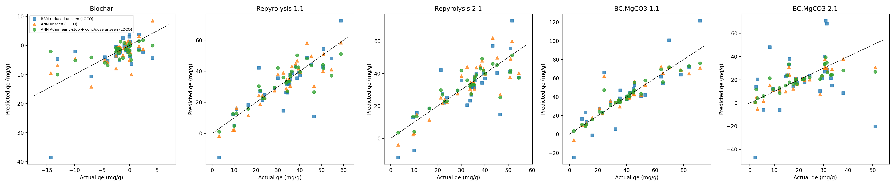

# Version 3: choosing the best model with repeated stratified 5-fold CV

**Run:** v3, final model selection
**Where:** Google Colab, **T4 GPU runtime** (mercurythefirst001@gmail.com account), notebook `rsm_ann_v3.ipynb` (in this folder)
**Colab link:** https://colab.research.google.com/drive/1CM81nmv71kRFWK9tKOnDr6FDrYOdZraL?authuser=4
**Run time:** about 35 minutes
**Outputs:** `RSM_ANN_v3_results.xlsx`, `actual_vs_predicted_v3.png`, `rsm_ann_v3.ipynb`
**Data used:** the same 480 lab measurements. **No value was changed, removed or synthesised.** The notebook's check passed: "all 480 measured qe values are unchanged".

---

## Contents
1. Why v3 was run
2. What v3 did, step by step
3. Result: ANN convergence (the "more epochs" question)
4. Result: model selection by 5-fold CV
5. Result: confirmation on the hold-out test and leave-one-out
6. Result: accuracy for each material
7. Result: actual vs predicted
8. Result: prediction at the optimum, and an important caveat
9. Final conclusions (v1 → v2 → v3)
10. Limitations

---

## 1. Why v3 was run

- **A fairer choice of the best model.** In v2 the best model was chosen by leave-one-out and then also reported on leave-one-out, which slightly flatters the winner. v3 *chooses* with one method (repeated 5-fold CV) and *confirms* with others (hold-out test and leave-one-out).
- **5-fold CV is the common convention** in published papers, so the numbers are easy to compare.
- **The epochs question:** would training the ANN longer help? v3 measures how many iterations the networks actually need.
- **Two new ANN types:** a 2-layer ANN, and an ANN trained with Adam plus early stopping.

---

## 2. What v3 did, step by step

| Step | What it does |
|---|---|
| 1. Data | Same 480 measurements. Centre runs 1–4 count as one condition (29 conditions per material). |
| 2. Models | All 12 models from v1 and v2, plus 2 new ANNs: **14 candidates** plus the ensemble. |
| 3. Convergence check | v1's ANN settings (9 combinations × 3 random seeds) trained on all data; iterations used recorded against the 5000 limit. |
| 4. Repeated stratified grouped 5-fold CV | The 29 conditions are split into 5 folds, 3 times with different shuffles: **15 train/test rounds**. **Grouped:** replicates of a run, and all 5 materials at that run, stay in the same fold. **Stratified:** each fold gets a fair share of every design block (centre; concentration, time, pH and dose one-factor runs; factorial; extreme corners). Every model is fitted **and tuned** from scratch inside each training fold. |
| 5. Selection | The model with the **lowest average error (RMSE) across the 3 repeats** is chosen. |
| 6. Confirmation | The chosen model is scored on the **untouched hold-out test** (runs 5, 12, 15, 18, 24, 27) and on **leave-one-condition-out** (29 folds), next to the baselines (RSM reduced and v1's ANN). |
| 7. Outputs | Actual vs predicted (every run, unseen); predictions at the lab validation settings; Excel and plot. |

**The two new ANNs**
- **ANN 2-layer + conc/dose:**
  - Two hidden layers of equal size (4 or 8 neurons), tanh activation.
  - L-BFGS solver with the iteration limit raised to 20,000.
  - L2 penalty {0.01, 0.1}; final model is the average of 10 networks.
- **ANN Adam early-stop + conc/dose:**
  - One hidden layer (4, 8 or 12 neurons), trained with the **Adam** optimiser.
  - 15% of the *training* rows are held back inside training; training **stops automatically** once their error has not improved for 50 epochs (limit 5000).
  - L2 penalty {0.01, 0.1}; final model is the average of 10 networks.
  - Inputs: conc, time, pH, dose, log(conc/dose), and material.

---

## 3. Result: ANN convergence (the "more epochs" question)

| v1 ANN setting | Iterations used (3 seeds) | Limit | Hit the limit? |
|---|---|---|---|
| 4 neurons | 223–869 | 5000 | No |
| 8 neurons | 317–969 | 5000 | No |
| 12 neurons | 383–1242 | 5000 | No |

**All 27 networks converged** within 223–1242 iterations, far below the 5000 limit. **Training longer would change nothing:** the networks had already reached their best fit and stopped on their own. This confirms that "more epochs" is not a way to improve accuracy here.

---

## 4. Result: model selection by repeated stratified 5-fold CV

Average over 3 repeats (± is the spread between repeats). Sorted by RMSE; lower is better.

| Rank | Model | 5-fold R² | 5-fold RMSE (mg/g) | 5-fold MAE (mg/g) |
|---|---|---|---|---|
| **1** | **ANN Adam early-stop + conc/dose** (new) | **0.903 ± 0.015** | **6.28 ± 0.50** | **4.35** |
| 2 | ANN 2-layer + conc/dose (new) | 0.880 ± 0.024 | 6.99 ± 0.69 | 4.51 |
| 3 | ANN + conc/dose (v2) | 0.876 ± 0.016 | 7.10 ± 0.44 | 4.89 |
| 4 | Ensemble ANN + GPR (v2) | 0.874 ± 0.016 | 7.18 ± 0.46 | 4.75 |
| 5 | ANN (v1) | 0.859 ± 0.018 | 7.57 ± 0.49 | 5.17 |
| 6 | Monotonic boosting (v2) | 0.834 ± 0.027 | 8.23 ± 0.64 | 5.80 |
| 7 | GPR + conc/dose (v2) | 0.821 ± 0.008 | 8.53 ± 0.18 | 5.54 |
| 8 | ANN removal-space (v2) | 0.562 ± 0.113 | 13.30 ± 1.68 | 5.85 |
| 9 | RSM weighted (v2) | 0.421 ± 0.116 | 15.34 ± 1.53 | 9.01 |
| 10 | RSM + ANN residual (v2) | 0.139 ± 0.570 | 18.12 ± 5.97 | 9.18 |
| 11 | RSM reduced (v1) | 0.130 ± 0.567 | 18.22 ± 5.92 | 9.52 |
| 12 | RSM full (v1) | −0.025 ± 0.692 | 19.72 ± 6.70 | 9.92 |
| 13 | GPR removal-space (v2) | −2.349 ± 0.056 | 36.99 ± 0.31 | 11.44 |
| 14 | RSM removal-space (v2) | −2.874 ± 1.044 | 39.55 ± 5.35 | 14.44 |

**Selected model: ANN Adam early-stop + conc/dose.**
- It is best by a clear margin: 0.7 mg/g lower error than the next model, and steady across repeats (± 0.015 in R²).
- Every ANN beats every RSM.
- RSM is especially unstable under 5-fold CV (± 0.57–0.69 in R²). Holding out 20% of the conditions removes many of the points a quadratic needs, which again shows that RSM is a model for **explaining** factor effects, not for **predicting** new conditions.

---

## 5. Result: confirmation on the hold-out test and leave-one-out

| Model | Hold-out R² | Hold-out RMSE | Hold-out MAE | LOCO R² | LOCO RMSE | LOCO MAE |
|---|---|---|---|---|---|---|
| **ANN Adam early-stop + conc/dose (v3)** | **0.937** | **3.81** | **2.61** | **0.903** | **6.29** | **4.10** |
| ANN (v1) | 0.918 | 4.34 | 2.63 | 0.876 | 7.11 | 4.71 |
| RSM reduced (v1) | 0.727 | 7.91 | 5.81 | 0.540 | 13.71 | 8.38 |

The selected model is **confirmed on both independent checks:**
- **Hold-out test:** R² **0.937**, the best of all versions (v2's best was 0.927).
- **Leave-one-out:** R² **0.903**, the best of all versions (v2's best was 0.887). Error **6.29 mg/g**, against 6.78 in v2 and 7.11 in v1.

Because choosing and confirming used different measures, these numbers are not flattered by the selection.

---

## 6. Result: accuracy for each material (R²)

| Material | Hold-out: RSM | Hold-out: ANN v1 | **Hold-out: v3** | LOCO: RSM | LOCO: ANN v1 | **LOCO: v3** |
|---|---|---|---|---|---|---|
| **BC:MgCO₃ 1:1** | 0.470 | 0.784 | **0.916** | 0.532 | 0.804 | **0.907** |
| Repyrolysis 1:1 | 0.112 | **0.968** | 0.946 | 0.455 | **0.755** | 0.737 |
| Repyrolysis 2:1 | 0.153 | **0.971** | 0.907 | 0.325 | 0.643 | **0.725** |
| BC:MgCO₃ 2:1 | −1.193 | 0.041 | **0.225** | −2.969 | **0.583** | 0.557 |
| Biochar (control) | −4.372 | −1.244 | **−0.267** | −0.970 | 0.228 | **0.366** |

- **BC:MgCO₃ 1:1 (best material): large improvement.** Leave-one-out R² went from 0.80 (v1) to **0.91**; average error is now 3.95 mg/g, down from 5.31.
- **Repyrolysis 2:1:** improved (0.64 → 0.73).
- **Repyrolysis 1:1 and BC:MgCO₃ 2:1:** about the same as v1 (within ±0.03).
- **Biochar:** better, but still low. That is expected for a control whose values are near zero and mostly noise.

---

## 7. Result: actual vs predicted (highest-qe run of each material, predicted while unseen)

| Material | Run (conc, time, pH, dose) | Actual qe | RSM | ANN v1 | **v3 model** |
|---|---|---|---|---|---|
| BC:MgCO₃ 1:1 | 19 (50, 180, 8, 10) | 91.5 ± 6.7 | 121.6 | 71.3 | **76.1** |
| Repyrolysis 1:1 | 31 (100, 60, 12, 10) | 58.8 ± 2.5 | 72.6 | 58.4 | **51.2** |
| Repyrolysis 2:1 | 26 (25, 240, 6, 20) | 54.4 ± 1.9 | 37.6 | 40.2 | **37.4** |
| BC:MgCO₃ 2:1 | 31 (100, 60, 12, 10) | 51.1 ± 3.5 | −20.3 | 30.7 | **26.9** |
| Biochar | 32 (100, 360, 4, 150) | 4.2 ± 0.2 | −4.3 | 8.5 | **0.0** |

The full table (all 32 runs × 5 materials) is in the Excel sheet "Actual vs predicted", and the plot is `actual_vs_predicted_v3.png`.

---

## 8. Result: prediction at the optimum, and an important caveat

| Material | Conc | Time | pH | Dose | RSM (v1) | v2 Ensemble | **v3 model** |
|---|---|---|---|---|---|---|---|
| BC:MgCO₃ 1:1 | 65 | 190 | 8.0 | 10 | 113.8 | 89.5 | **68.2** |
| Repyrolysis 1:1 | 30 | 160 | 4.5 | 15 | 61.4 | 51.8 | **45.8** |
| Repyrolysis 2:1 | 30 | 150 | 5.0 | 10 | 65.2 | 50.1 | **48.4** |
| BC:MgCO₃ 2:1 | 100 | 230 | 8.0 | 15 | 54.7 | 40.3 | **43.5** |

**Caveat: the v3 model under-predicts the very highest qe values.**
- The v3 model is the most accurate **on average** across all conditions. But at the **extreme low-dose, high-qe corner** it predicts too low:
  - for BC:MgCO₃ 1:1, run 19 measured **91.5** and v3 predicted **76.1**
  - at the optimum settings v3 predicts **68.2**, while a nearby measured run reached 91.5
- **Why:** early stopping deliberately keeps the network smooth to avoid overfitting. That makes it excellent on typical conditions but pulls its predictions toward the middle at the extreme edge of the data, where there are few points. Here the v2 ensemble was better (it predicted run 19 as 93.4 unseen).
- **RSM goes the other way:** it over-predicts at the same corner (121.6 for run 19).

**Practical recommendation for the optimum**
- The most reliable estimate is the **measured data**: BC:MgCO₃ 1:1 reached **91.5 mg/g** at 50 ppm, 180 min, pH 8, 10 mg.
- Expect about **70–95 mg/g** at the recommended optimum (65 ppm, 190 min, pH 8, 10 mg).
  - The low end is the v3 model's cautious estimate.
  - The high end is from the measured run and the v2 ensemble.
  - RSM's 114 is very likely too high.
- **The lab validation run settles this:** run 65 ppm, 190 min, pH 8, 10 mg with 3 replicates.

---

## 9. Final conclusions (v1 → v2 → v3)

| | v1 | v2 | **v3** |
|---|---|---|---|
| Best prediction model | ANN | Ensemble ANN + GPR | **ANN (Adam, early stopping) + conc/dose** |
| How the best was chosen | — | LOCO | **Repeated stratified 5-fold CV** (fairer) |
| 5-fold CV R² | 0.859 | 0.874–0.876 | **0.903** |
| Hold-out test R² | 0.918 | 0.927 | **0.937** |
| Leave-one-out R² | 0.876 | 0.887 | **0.903** |
| Leave-one-out error (RMSE) | 7.11 mg/g | 6.78 mg/g | **6.29 mg/g** |
| Best material (ANOVA) | BC:MgCO₃ 1:1 | same | same |
| Optimum conditions | 65 ppm, 190 min, pH 8, 10 mg | same | same |

**What to report**
1. **Goal 1 (optimum):** BC:MgCO₃ 1:1 at 65 ppm, 190 min, **pH 8**, **10 mg**, from RSM with pH limited to 4–8. Expected qe about 70–95 mg/g; to be confirmed in the lab.
2. **Goal 2 (best material):** BC:MgCO₃ 1:1, by two-way ANOVA and Tukey HSD (p < 0.001), with the RSM ANOVA tables for factor significance (see `results/v1/V1_REPORT.md`).
3. **Goal 3 (actual vs predicted):** use the **v3 model**. It is the most accurate overall, chosen fairly and confirmed independently:
   - **R² = 0.937** on the hold-out test
   - **0.903** on 5-fold CV and on leave-one-out
   - average error about **4 mg/g**

   Mention that it under-predicts the highest-qe runs.
4. **The epochs question is answered:** all networks converge well before the iteration limit. Better accuracy came from **early stopping** (stopping at the right time) and from the **conc/dose input**, not from training longer.

---

## 10. Limitations

- **Small data:** 29 conditions per material. Five-fold splits with grouping produce uneven fold sizes (3–7 conditions per fold).
- **Early stopping's internal validation rows** are drawn at random from the training rows, so replicates of a training condition can sit on both sides *inside training*. This does **not** leak into any test or confirmation score (those conditions are always fully held out), but it can make the stopping point slightly less precise.
- **Extreme corners** (lowest dose, highest qe) are the hardest to predict for every model, and this is exactly where the optimum lies. Lab validation is essential.
- **Measurement noise** (replicate SD up to about 7 mg/g at run 19) limits how precisely any model can match individual runs.

